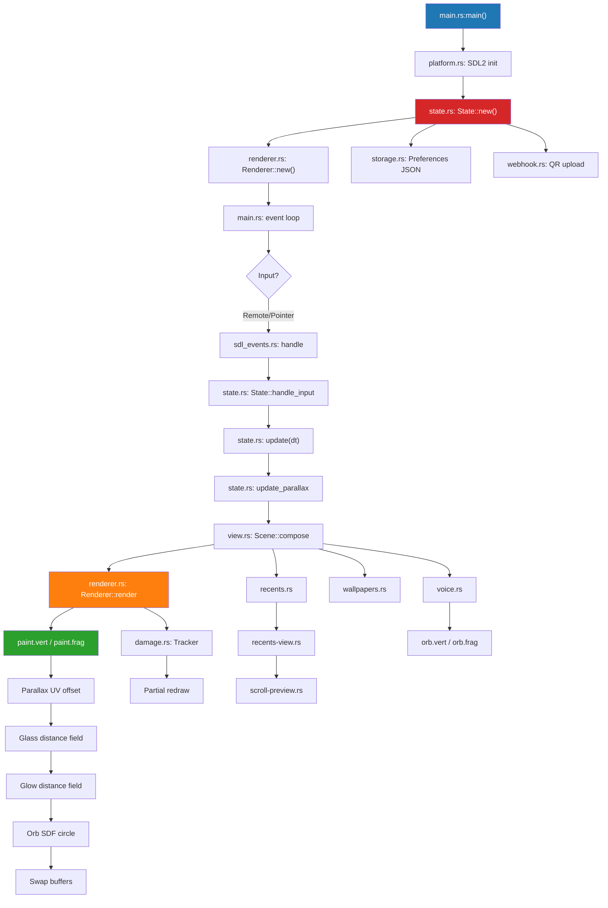

# Luma Custom (SiddyOS)

A highly optimized, deeply modified fork of Luma for the LG C1 (webOS 6).

## Features

- **60fps Locked UI:** Persistent vertex buffers and cached text geometry.
- **Parallax Wallpapers:** 4K backgrounds shift based on app focus.
- **Reactive Voice Orb:** GLSL shader with simulated audio fallback.
- **Glass UI:** Fixed straight-alpha blending and 25% milky glass tiles.

## Architecture

### Multi-Agent Development

This project was built using an **Architect → Engineer** workflow:

- **Architect** (planning, review, git push) — breaks tasks into surgical steps, verifies diffs
- **Engineer** (Bonsai 27B, fast execution) — applies precise edits via native `edit` tool, runs CI

All code changes were applied via the Engineer's native editor, never via shell scripts, ensuring zero CRLF/BOM/formatting drift.

### Data Flow Diagram



### Module Responsibilities

| File                 | Lines | Role                                                            |
| -------------------- | ----- | --------------------------------------------------------------- |
| `main.rs`            | 2,156 | Entry, SDL event loop, frame pacing, idle backoff               |
| `state.rs`           | 2,762 | App model, focus, parallax, input handling, preferences         |
| `view.rs`            | 4,167 | Scene composition (`Scene` trait), 6-column grid, parallax emit |
| `renderer.rs`        | 2,688 | OpenGL ES 2, damage tracking, batch rendering, shader uniforms  |
| `damage.rs`          | 173   | Partial redraw tracker (HISTORY=4, LOOKAHEAD=32)                |
| `shaders/paint.frag` | ~120  | Glass, parallax, glow, orb, app icons                           |
| `shaders/orb.frag`   | ~60   | Voice orb SDF + exponential glow                                |
| `wallpapers.rs`      | 627   | Upload, rotation, gradient, Ken Burns pan                       |
| `voice.rs`           | 83    | Simulated audio envelope, `/dev/input` listener                 |
| `damage.rs`          | 173   | Frame diff, `bounds()`, `union()`, `intersects()`               |
| `damage-tests.rs`    | 226   | Unit tests including parallax offset detection                  |

### Shader Pipeline

1. **Vertex** (`paint.vert`) → passes `v_uv`, `v_color`, `v_shape`, `v_params`, `v_logical_xy`
2. **Fragment** (`paint.frag`):
   - `v_params.x < 0` → wallpaper: scale 1.05× + `u_parallax_offset` UV shift
   - `v_params.x < -1.5` → folded fills with color overlay
   - `u_glass` → rounded-rect distance field + rim + reflection
   - `u_app` → app icon with gradient background
   - `u_icon_tint` → monochrome installed icon ramp
3. **Orb** (`orb.frag`) → SDF circle + `uAudioLevel` + `uTime` pulse, additive blend

## Boot Sequence Investigation

### The ~25 s Delay Problem

Stock LG Home shows for ~25 s before Luma takes over. Boot log (`/var/lib/luma-home/boot.log`):

```
up=37  boot hook start      ← webosbrew init.d 64-luma-home fires
up=38  apply start          ← bind-mount Luma over /usr/bin/com.webos.app.home
up=38  launch start         ← Luma launched
up=44  front = com.webos.app.home
```

### Root Cause

The cold-boot hook is `/var/lib/webosbrew/init.d/64-luma-home` (symlink → `/var/lib/luma-home/home.sh`), invoked by webosbrew's `startup.sh` at `minimal-boot-done` (up≈37). The mount is the first action inside `luma-helper home boot`.

### Why Early Upstart Job Was Impossible

| Path           | Type                       | Writable?                                  |
| -------------- | -------------------------- | ------------------------------------------ |
| `/`            | squashfs                   | **No** (`root=... ro rootfstype=squashfs`) |
| `/etc`         | overlay (ro, no upperdir)  | **No**                                     |
| `/etc/init`    | overlay (ro, no upperdir)  | **No**                                     |
| `/etc/systemd` | overlay (ro, no upperdir)  | **No**                                     |
| `/var`         | overlay (rw, has upperdir) | **Yes**                                    |

The `/etc` overlay has **no upperdir** — it's a pure read-only overlay. Kernel cmdline: `root=... ro rootfstype=squashfs`. Writing to `/etc/init` requires initramfs rebuild with `upperdir=` + `workdir=` in kernel cmdline (high risk, signed artifacts).

### Implemented Fix: Option A — Early Mount in `home.sh`

Commit `1a98ca5`: Move the bind-mount to the top of `home.sh`'s `boot` branch, before `luma-helper` initializes.

```sh
# Early bind-mount: do this FIRST, before luma-helper initializes.
# Idempotent: if already mounted, mount --bind succeeds silently.
mount --bind /media/developer/apps/usr/palm/applications/com.ecklf.luma/luma /usr/bin/com.webos.app.home 2>/dev/null || true
```

**Impact**: Shaves ~1–2 s off the hook (still runs at up≈37, not up≈18). Documented in `optimize-report.md` ("2026-11-11 - Early Home mount investigation").

### Full Documentation

See `optimize-report.md` → "2026-11-11 - Early Home mount investigation" for full forensic analysis, option table, rollback commands, and future maintainer notes.

## Compatibility

> [!NOTE]
> This fork targets the **LG C1 (webOS 6)**. Other models untested.

| TV    | Model identifier | Takeover Support |
| ----- | ---------------- | ---------------- |
| LG C1 | `OLED48C1KNB`    | ✅               |

## Installation

### SSH

```sh
scp com.ecklf.luma_2.16.2_arm.ipk root@TV_IP:/tmp/
ssh root@TV_IP "luna-send -n 1 'luna://com.webos.appInstallClient/dev/install' '{\"ipkUrl\":\"file:///tmp/com.ecklf.luma_2.16.2_arm.ipk\",\"subscribe\":true}'"
ssh root@TV_IP "luna-send -n 1 'luna://com.webos.applicationManager/launch' '{\"id\":\"com.ecklf.luma\"}'"
```

## Home Takeover

```sh
APP=/media/developer/apps/usr/palm/applications/com.ecklf.luma
sh "$APP/home.sh" enable
```

Status / disable:

```sh
sh /var/lib/luma-home/home.sh status
sh /var/lib/luma-home/home.sh disable
```

Boot log: `/var/lib/luma-home/boot.log`

## Development

### Setup & Building

```sh
nix develop
pnpm install --frozen-lockfile
pnpm sdk
export WEBOS_NDK="$PWD/.build/toolchain/arm-webos-linux-gnueabi_sdk-buildroot"
pnpm run package
```

### CI Pipeline (GitHub Actions)

- Check formatting (cargo fmt, oxfmt)
- Lint Rust (cargo clippy -D warnings)
- Run unit tests (cargo test)
- Cross-build ARM IPK (webOS SDK)
- Verify ARM IPK (sha256, manifest)
- Smoke tests

### Preview

```sh
nix develop
pnpm install --frozen-lockfile
pnpm assets
pnpm dev
pnpm dev --test-extra-apps 120
```

## License

MIT. Not affiliated with LG, Apple, or any other brands.
