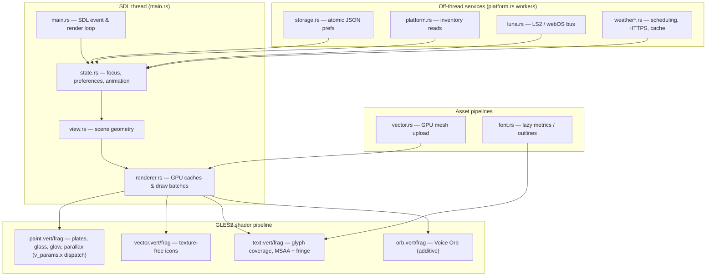

# Luma

A native launcher for rooted LG webOS TVs, inspired by Apple TV.

https://github.com/user-attachments/assets/3d3564d9-5942-4aef-a726-0323f5e86a07

<details>
<summary>Screenshots</summary>

<table>
  <tr>
    <td width="50%" align="center">
      
    </td>
    <td width="50%" align="center">
      
    </td>
  </tr>
  <tr>
    <td width="50%" align="center">
      
    </td>
    <td width="50%" align="center">
      
    </td>
  </tr>
</table>

</details>

## Compatibility

> [!NOTE]
> Luma should start on any TV running webOS 4 or newer. The following configurations have been
> confirmed to work by the community. Home takeover support varies, as noted below:

<details>
<summary>webOS 4</summary>

| TV        | Model identifier | Takeover Support |
| --------- | ---------------- | ---------------- |
| LG C8     | `OLED??C8*`      | ❌               |
| LG C9     | `OLED65C97LA`    | Unknown          |
| LG UM7450 | `UM74507LA`      | ❌               |

</details>

<details>
<summary>webOS 5</summary>

| TV        | Model identifier | Takeover Support |
| --------- | ---------------- | ---------------- |
| LG UN7100 | `49UN71006LB`    | ✅               |

</details>

<details>
<summary>webOS 6</summary>

| TV        | Model identifier | Takeover Support |
| --------- | ---------------- | ---------------- |
| LG C1     | `OLED48C1KNB`    | ✅               |
| LG UP8000 | `86UP80009LA`    | Unknown          |

</details>

<details>
<summary>webOS 24</summary>

| TV    | Model identifier | Takeover Support |
| ----- | ---------------- | ---------------- |
| LG B2 | `OLED65B29LA`    | ✅               |

</details>

<details>
<summary>webOS 25</summary>

| TV        | Model identifier | Takeover Support |
| --------- | ---------------- | ---------------- |
| LG B5     | `OLED77B5PUA`    | ✅               |
| LG C2     | `OLED42C2PSA`    | ✅               |
| LG C2     | `OLED65C2*`      | Unknown          |
| LG C2     | `OLED77C2*`      | Unknown          |
| LG C4     | `OLED42C4*`      | ✅               |
| LG G3     | `OLED??G3*`      | Unknown          |
| LG NANO77 | `55NANO776RA`    | ✅               |
| LG QNED86 | `55QNED86T6A`    | Unknown          |
| LG UT8050 | `50UT8050*`      | ✅               |

</details>

<details>
<summary>webOS 26</summary>

| TV    | Model identifier      | Takeover Support |
| ----- | --------------------- | ---------------- |
| LG C2 | `OLED65C2PSA`         | ✅               |
| LG C3 | `OLED65C31LA`         | ✅               |
| LG C3 | `OLED65C36LC`         | ✅               |
| LG C5 | `OLED55C57LA`         | ✅               |
| LG C5 | `OLED55C5PSA`         | Unknown          |
| LG C6 | `OLED65C6*`           | Unknown          |
| LG C6 | `OLED77C6*`           | ✅               |
| LG G5 | `OLED83G5WUA.BUSYDJR` | ✅               |
| LG G5 | `OLED77G5WUA.DUSQLJR` | ✅               |

</details>

## Installation

### Homebrew Channel

```text
https://github.com/ecklf/lg-luma/releases/latest/download/repo.json
```

### SSH

On your computer, replace `TV_IP`:

```sh
scp -O dist/com.ecklf.luma_2.16.2_arm.ipk root@TV_IP:/tmp/luma.ipk
ssh root@TV_IP
```

In the TV's root shell:

```sh
luna-send -i luna://com.webos.appInstallService/dev/install \
  '{"id":"com.ecklf.luma","ipkUrl":"/tmp/luma.ipk","subscribe":true}'
```

## Replacing LG Home

### Takeover Method

> [!NOTE]
> Takeover is supported on **webOS 5, 6, 25 and 26**.\
> The takeover does not delete LG Home: it remains underneath a temporary mount, which is cleared by
> a reboot. If Luma is uninstalled first, LG Home returns on reboot, but the separate takeover boot
> hook remains and logs an error because it can no longer find Luma. No TV reset is needed. For
> clean removal, disable takeover before uninstalling.

Install Luma and verify that it opens normally. Disable any Home-button mapping in
[LG Input Hook](https://github.com/Simon34545/lginputhook) (remove its Home-key action) and any
other Home replacement, then run in the TV's root SSH shell:

If you enabled Lumas autostart method earlier, disable it first:

```sh
APP=/media/developer/apps/usr/palm/applications/com.ecklf.luma
sh "$APP/autostart.sh" disable
```

To enable the takeover run:

```sh
APP=/media/developer/apps/usr/palm/applications/com.ecklf.luma
sh "$APP/home.sh" enable
```

To see the status or disable the home override use:

```sh
sh /var/lib/luma-home/home.sh status
sh /var/lib/luma-home/home.sh disable
```

`restore` is an alias for `disable`.

Boot log: `/var/lib/luma-home/boot.log`. See the
[development guide](development.md#optional-native-home-integration) for implementation details.

<details>
<summary>Method for webOS 5 / 6</summary>

On **webOS 5 and 6**, SAM cannot reread a mounted Home manifest, so `home.sh enable` instead
bind-mounts Luma's executable over LG's `/usr/bin/com.webos.app.home`. LG's Home manifest stays
in place and Luma registers with SAM itself, so the Home key brings the running Luma back instead
of restarting it. The commands and the cold-boot hook are the same.

</details>

<details>
<summary>Method for webOS 25 / 26</summary>

Mounts Luma over the system Home app and reapplies the mount at cold boot. The LG splash
shown before Luma's window opens is the wallpaper you selected in **Settings → Background**, staged
from the saved preferences at each boot. Normal app launches also use your selected wallpaper:
Luma updates the launch splash through Homebrew Channel's root service after loading or saving your
settings. Open Luma once after installing or updating so subsequent launches use your saved background.
LG Home's original files remain underneath, using the same approach as
[Glasshouse Home](https://github.com/rorygallagher2024/glasshouse/blob/main/server/lib/home-takeover.js).

</details>

### Autostart Method

Open Luma 25 seconds after a full cold boot. Run in the TV's root SSH shell:

```sh
sh /media/developer/apps/usr/palm/applications/com.ecklf.luma/autostart.sh enable
```

Use this when takeover is disabled. It launches Luma as a regular app and does not remap the Home button.

Disable before enabling takeover or uninstalling Luma:

```sh
sh /media/developer/apps/usr/palm/applications/com.ecklf.luma/autostart.sh disable
```

### LG Input Hook Method

You can use [LG Input Hook](https://repo.webosbrew.org/apps/org.webosbrew.inputhook/), configure an Execute action with this one-line command:

```sh
/usr/bin/luna-send -n 1 -w 5000 luna://com.webos.service.applicationmanager/launch '{"id":"com.ecklf.luma"}'
```

Test on a spare button first. Disable the mapping in Input Hook to restore normal Home behavior.

## Features

### Backgrounds

Open **Settings → Background → Upload**, then scan the QR code or open the shown
address on a phone or computer on the same network. Choose a JPEG, PNG or WebP and adjust
its 16:9 crop before choosing **Save to TV**.

The upload link works only while its TV dialog is open and focused.

Enable **Rotation** beside **Upload** to cycle through backgrounds on each Luma restart and every
15 minutes with a slow cross-fade. Rotation is off by default and leaves your manually chosen
LG splash unchanged.

Toggle **Gradient** beside **Rotation** to turn background shading on or off. It defaults to On
and remembers your choice. Older uploads without an unshaded copy keep their full-resolution
shaded image. This does not change LG's launch splash.

### Recent app switching

Press **Back** on Home, or hold **Back** for 0.6 seconds from any page, to open Recent apps.

- **Left / Right**, the pointer, or the scroll wheel browses recent apps and inputs.
- **OK** or a pointer click opens the selected app or input.
- **Up** closes the selected app and removes its card.
- **Back** dismisses the switcher and restores the previous page and focus.

These shortcuts work while Luma is focused. From another app, return to Luma first.

### Shortcut tiles

Shortcut tiles sit on Home like apps but send a web request when selected, for example to a Home
Assistant webhook. Open **Settings → Widgets → Shortcuts → Configure** and scan
the QR code.

### 60 fps pacing

Luma is vsync-paced and runs at the panel's refresh rate. A dedicated `optimize` branch (unmerged;
built from `custom/glass-ui`, head `725087e`) made a series of pixel-neutral pacing improvements:
full LTO, no CPU spin while animating when SDL refuses vsync, pre-sized wallpapers and oversized
icons (Lanczos3) instead of a GPU downscale every frame, a cached nav/header layout, single-pass
caption measurement, culling of Apps rows that start past the viewport, and an idle backoff that
sleeps up to 1 s between polls. Steps 1–7 were pixel-neutral; one commit (`68c632c`) deliberately
changes the focus glow to fix banding (see [Glass UI](#glass-ui)).

Measured on an LG C1 (webOS 6, `OLED48C1KNB`) with `--profile-frames` over 400 forced Apps
presentations, base `glass-ui` versus `optimize` (mean / p95, ms):

| Metric               | base `glass-ui`             | `optimize`                  |
| -------------------- | --------------------------- | --------------------------- |
| compose (CPU layout) | 0.80 – 0.83 / 0.95 – 1.11   | 0.59 – 0.65 / 0.74 – 1.01   |
| CPU submission       | 17.97 – 18.09 / 32.3 – 32.7 | 18.01 – 18.07 / 32.5 – 32.8 |
| Frame pacing         | 20.12 – 20.34 / 34.4 – 34.9 | 19.91 – 20.08 / 34.4 – 34.8 |
| Swap                 | 1.15 – 1.21 / 1.6 – 1.9     | 1.15 – 1.18 / 1.5 – 1.8     |

Compose (the CPU layout pass the steps target) is ~22–26 % cheaper; CPU submission is unchanged
because it is dominated by the GL submission path; frame pacing improves ~1 %. The Apps page runs
at **~50 fps** on this panel under a TV load average of ~14 in both builds — the sustained load is
LG's own power-management kernel threads in `D` state, not Luma. This is not a 60 fps guarantee:
per the development guide, "Do not infer 60 fps from a successful VSync request; measure actual TV
pacing and transitions."

### Parallax

The wallpaper eases behind the focused Apps tile. This runs only on the Apps page — Home
favourites are a 1-D strip and keep the wallpaper still. The focused cell's column in the
six-column grid (`APPS_COLUMNS = 6`) maps to a horizontal UV offset of
`[(col / (cols - 1) * 2 - 1) * 0.024, 0.]` — up to ±2.4 % of the texture width, never vertical.
The shader scales the sample window to 1.05 (`parallax_uv = (v_uv - 0.5) * (1.0 / 1.05) + 0.5 +
u_parallax_offset`, `src/shaders/paint.frag`) so the offset never reaches the clamped texture edge.

The offset eases with `1 - (-20 * ease).exp()`, where `ease =
last_frame.elapsed().as_secs_f32().min(1./30.)` (`src/main.rs`), so a wake from idle consumes
at most two frame steps and the ramp stays visible. Once the offset settles it stops requesting
frames and the idle backoff resumes.

### Voice Orb

A reactive orb fades in while the remote's mic key is held, and the Settings row previews it. The
listener (`src/voice.rs`) is best-effort: webOS maps the voice key (evdev 428, `RF_VOICE`) to an
unknown scancode, so only Luma-as-Home/root can read the remote's device. `listen()` polls
`/dev/input/event{0..15}` non-blockingly and forwards key 428 as an SDL `Event::User`.

The orb's fade is `VOICE_FADE = 0.2 s` driven by the frame delta, and the level is smoothed with
`1 - (-10 * dt).exp()`. The `voice_orb` preference defaults to `true` (`.changeset/reactive-voice-orb.md`
is a minor bump). Real remote-mic PCM is not yet reachable on the TV — the `voiceinput` service's
device table is empty, and ALSA `hw:1,0` is the TV's built-in PDM mic, not the remote — so
`real_voice_level()` returns `None` and the orb falls back to `simulated_voice_level()`, a
clearly marked synthetic envelope. This plug point is parked, not improvised.

### Glass UI

App tiles are one analytic pass in `paint.frag` (`Draw::Glass` / `PaintMode::Glass`): a
smoked-glass plate with a vertical tint, a 3 px soft inner rim, a 1 px crisp rim, and a top
reflection that fades to the bottom edge.

The focus glow was the main banding culprit. The old `view::Scene::glow()` pushed five filled
rounded shapes (insets 6/12/20/30/42 px, flat alphas 0.24/0.165/0.105/0.06/0.038); each flat
alpha composited into concentric plateaus with hard edges. The new `Draw::Glow(Rect, radius,
blur, Color)` → `PaintMode::Glow` is one rounded-rect distance field with a hold-then-exponential
falloff (`hold = blur * 0.1`, `decay = blur * 0.2`, edge alpha `0.49 → 0.42`), with the residual
subtracted at the quad edge so the halo reaches exactly zero at the geometry edge. Measured across
a focused Apps tile: hard step edges 4 → 0, flat plateau pixels 15 → 2, and the halo ~8–11 %
dimmer beside the card and gone by 60 px. The curve is monotonic, so there is nothing to band.

## Development

### Setup & Building

From the repository root, with Nix flakes enabled:

```sh
nix develop
pnpm install --frozen-lockfile
pnpm sdk
export WEBOS_NDK="$PWD/.build/toolchain/arm-webos-linux-gnueabi_sdk-buildroot"
pnpm run package
```

The first native runtime preparation also downloads a
checksum-pinned SDL-webOS library; both downloads are cached under `.build/`.

Output:

```text
dist/com.ecklf.luma_2.16.2_arm.ipk
dist/sha256sums
dist/repo.json
dist/app-icon-large.png
```

Open [webOS Dev Manager](https://github.com/webosbrew/dev-manager-desktop), connect to the TV's
IP on port **22** as **root**, and install the IPK. Open **Luma** from the TV menu. Homebrew
Channel must be elevated; on webOS 26 use **0.8.0-rc1 or newer** for its `lunabus.query` mapping.

The native package uses **`com.ecklf.luma`** and installs separately from the old
`com.luma.launcher` web app and the former `com.luma.launcher.native` / `com.luma.native` prototypes. Native preferences
are local JSON files and are separate for each installation; browser preferences are not migrated.
Homebrew Channel treats this ID as a separate app rather than an update to the old launcher.

Wait for installation success; Ctrl+C closes an ongoing subscription. Fully close and reopen
Luma after updating. The [development guide](development.md#tv-startup-diagnostics) has a jailed
launch command that exposes errors hidden by the normal menu launch.

### Multi-Agent Development

There is no repo-backed multi-agent development workflow. The only agent artifact in the repository
is the skill directory `.agents/skills/cinematic-shot/`, a cinematic product-film capture skill
(references `look.md` and `shot-list-example.md`). No multi-agent orchestration, prompt pipeline,
or automated review process is implemented or documented.

## Preview

```sh
nix develop
pnpm install --frozen-lockfile
pnpm assets
pnpm dev
```

The desktop preview uses sample inventory and never calls TV services. To manually exercise a
longer app grid:

```sh
pnpm dev --test-extra-apps 120
```

Preview preferences are separate from normal preferences. See [development.md](development.md)
for controls, vector rendering, diagnostics, tests and the source layout.

For release-worthy changes, include a file generated by `pnpm changeset` in your PR. The automated
Version Packages PR synchronizes app versions and publishes after merging and passing CI.
See [Releases](development.md#releases) for the workflow and repository setup.

## Architecture

> [!NOTE]
> The diagram below is reconstructed from the source layout and the `development.md` module notes;
> it is not a verbatim diagram from the repository.



Module responsibilities (from `development.md`):

- `state.rs` — focus/preferences
- `view.rs` — geometry
- `renderer.rs` — GPU caches/draws
- `font.rs` — lazy metrics/outlines
- `vector.rs` — GPU mesh upload
- `platform.rs` — worker/inventory
- `luna.rs` — LS2
- `weather*.rs` — scheduling/HTTPS/cache
- `storage.rs` — atomic JSON
- `main.rs` — SDL loop

Shader pipeline (all GLES2):

- `paint.vert`/`paint.frag` — UI plates, glass, glow, parallax; `v_params.x` dispatches to
  parallax (`< 0`), glow/shadow (`>= 0`), and the glass plate (`u_glass.w > 0.5`).
- `vector.vert`/`vector.frag` — texture-free icons.
- `text.vert`/`text.frag` — glyph coverage with MSAA and a narrow fringe fallback.
- `orb.vert`/`orb.frag` — the Voice Orb (additive, premultiplied).

## Boot Sequence Investigation

The six boot scripts live in the parent `luma/` directory (not `src-repo/`). They enable, verify,
and inspect the Home takeover and the boot-logo wallpaper staging.

| Script               | Purpose                                                            | Key actions                                                                                                                                                                                                                                    |
| -------------------- | ------------------------------------------------------------------ | ---------------------------------------------------------------------------------------------------------------------------------------------------------------------------------------------------------------------------------------------- |
| `pre_takeover.sh`    | Pre-flight before enabling takeover                                | Launches Luma to verify it opens; `pgrep` for the process; `autostart.sh disable` as a safety step; lists `/var/lib/webosbrew/init.d/`; searches for LG Input Hook across app/service directories and prefs; checks for a running `inputhook`. |
| `enable_takeover.sh` | Enables the webOS 6 takeover path                                  | `printf 'y\n' \| sh "$APP/home.sh" enable`; prints status; greps `/proc/mounts` for the `/usr/bin/com.webos.app.home` bind mount; lists the `64-luma-home` cold-boot hook; `pgrep` for Luma.                                                   |
| `verify_takeover.sh` | Post-enable verification                                           | `ps -ef` for Luma/Home; `ls -l /usr/bin/com.webos.app.home`; `grep com.webos.app.home /proc/self/mountinfo`; lists `/var/lib/luma-home/`; tails `boot.log`; runs `home.sh status`.                                                             |
| `boot_apply.sh`      | Stages a boot-logo wallpaper with rotation off, then restarts Home | Kills `com.webos.app.home`; copies patched `preferences.json` **after** the kill (so a SIGTERM flush cannot restore the old background); relaunches Home via `luna-send`; verifies the prefs and wallpaper entries.                            |
| `boot_wallpaper.sh`  | Stages the Luma boot logo as a custom wallpaper entry              | Creates `wallpapers/<custom-id>` (32-hex id) and `metadata.json`; expects regular (non-symlink) `wallpaper.jpg`/`thumbnail.jpg` under 12 MiB; prints hashes.                                                                                   |
| `luma_state.sh`      | Inspects Luma's foreground/lifecycle state                         | Backs up `preferences.json`; `getForegroundAppInfo`; `getAppLifeStatus` for `com.ecklf.luma` and `com.webos.app.home`; `ps -ef` for both.                                                                                                      |

### Home lifecycle

**webOS 5/6 — bind-mount over `/usr/bin/com.webos.app.home`.** SAM restarts a v1 native Home on
every Home launch, so the manifest takeover does not apply. A root integration instead bind-mounts
the installed `luma` executable over LG's `/usr/bin/com.webos.app.home`. SAM then starts it with
LG's own Home manifest and LS2 role, which is bound to that executable path. Luma detects this
(`platform::runs_as_lg_home`) and:

- disables SDL's own app registration (which cannot reach the bus under LG's Home role) and
  registers with SAM itself via `registerApp` (lifecycle v2) on its own LS2 connection;
  `luna::subscribe` waits up to 10 s for SAM's first reply — a failed connection, call, or refused
  registration is a startup error, so Luma exits and SAM starts Home afresh.
- claims SDL-webOS's Home key, returning directly to the Home tab when SAM does not relaunch an
  already-foreground Home.
- resolves `assets/`, `lib/` (extra RPATH) and the splash directory from the installed package,
  since `current_exe()` names LG's path.
- writes stderr to `/tmp/luma-home.log` (SAM discards a system app's output) and skips the
  per-icon elevated-service fallback (as root, every file is readable).

`enable` and the boot hook bind-mount the installed executable over that path, stop the previous
Home process, and open Home if it was in front. Luma in front within about 15 s is the success
condition, with one repeated launch after 6 s. A mount whose source is Luma's executable counts as
its own also after a package update (`//deleted`) and is replaced; any other mount over LG's
executable is refused. `disable`/`restore` unmounts (lazily while Home runs), stops Luma, and
reopens LG Home if Home was in front. A cold boot without the hook gives LG's Home back. Verified
on an LG 49UN7100 (webOS 5): Home key to Luma in about 0.4 s instead of a restart of about 2 s.

**webOS 10/11 — staged manifest + `luna::subscribe_as_app`.** With the staged manifest, SAM starts
Luma's own executable for `com.webos.app.home`, but never as a registered app: on every Home key
it kills Luma and starts it again. Running in place of LG's executable is not an option here,
because LG Home's role is app-ID based (`"appId": "com.webos.app.home"`), not path-bound, and
Luma's role only allows `com.ecklf.luma` or an anonymous name.

Running as root, the system-bus `luna-send -a` may act for an app ID. So when `options.webos_home`
is set outside LG's executable path and the effective user is root, Luma calls
`luna::subscribe_as_app`, which runs `app_subscription::subscribe` with a child
`luna-send -a com.webos.app.home -i` that holds `registerNativeApp`. SAM expects lifecycle v1 for
this manifest and refuses `registerApp` with "unmatched method with nativeLifeCycleInterfaceVersion".
v1 names its events in `message` rather than `event`; `platform::Lifecycle::from_reply` reads
both and feeds the same `relaunch`/`close` handling as v2.

- Startup does not wait for SAM; until it answers, Home is simply unregistered.
- No answer within 10 s, a refused answer, or the child ending before an answer kills and reaps
  the child and leaves Home unregistered (SAM restarts it per Home key). Once SAM accepts the
  registration, losing it quits Luma so SAM starts Home afresh.
- The child gets `SIGKILL` when Luma's main thread ends (`PR_SET_PDEATHSIG`, re-checked against
  the parent PID after arming).
- On `relaunch`, Luma restores, shows, and raises its window. If a relaunch arrives while Luma is
  not both focused and visible, `platform::ForegroundCheck` waits 3 s for `FocusGained` or a
  remote key.

Verified on an LG OLED65C36LC (webOS 26, 11.2.0-3701): without registration the Luma PID changes
on every Home key; with it, the PID stays the same across Home presses and Back out of apps, SAM
sends `relaunch` with `launchType: homeKey`, and it registers again after a cold boot.

### Early-Home-mount investigation (2026-11-11)

Goal: reduce the ~25 s delay where stock LG Home shows before Luma takes over. The boot log
(`/var/lib/luma-home/boot.log`) showed the webosbrew init.d hook (`64-luma-home` → `home.sh boot`
→ `luma-helper home boot`) fires at up~37, then mount at up=38, Luma launch at up=38. The target
was the mount at up~10–15 so that when bootd launches `com.webos.app.home` at its natural
firstAppInHome time (up~18), the binary is already Luma.

Findings:

- Root cause: the cold-boot hook is `/var/lib/webosbrew/init.d/64-luma-home` (symlink →
  `/var/lib/luma-home/home.sh`), invoked by webosbrew's `startup.sh` at up~37. The mount is the
  first action inside `luma-helper home boot`.
- Bootd launches the first app at `firstAppInHome` time (~up=18) on `mount-readwrite-done`.
- `/etc/init` and `/etc/systemd/system` are read-only overlays with no `upperdir` (kernel cmdline
  `root=... ro rootfstype=squashfs`), so a new upstart job, systemd service, or bind.fstab entry is
  impossible without an initramfs rebuild.

Options evaluated: a new upstart job, a systemd service, and a bind.fstab entry — all impossible
(read-only overlay). "Optimize existing hook" (move the mount to the top of `home.sh` before
`luma-helper` init) works; "Optimize startup.sh ordering" is possible but riskier.

Decision: abandoned the early upstart job. Implemented Option A — an early mount in `home.sh`'s
boot path (commit `1a98ca5`): an idempotent `mount --bind` of the Luma executable over
`/usr/bin/com.webos.app.home` at the top of the boot branch, before `luma-helper` initializes,
with errors suppressed. This shaves the ~1–2 s `luma-helper` init overhead. The mount still
happens at up~37, not up~18, so it does not beat bootd's first-app launch; the ~25 s
stock-Home-visible delay is fundamentally caused by webosbrew's `startup.sh` running at
`minimal-boot-done` (up~37). No risk of double-launch: the late hook still runs but finds the
mount already active.

Rollback: `git revert 1a98ca5 && git push origin optimize`, or on the TV
`umount /usr/bin/com.webos.app.home` (re-applied by `64-luma-home` on next boot).

## License

Luma is licensed under MIT.\
Luma is not affiliated with LG, Apple, or any other brands shown in its UI.
